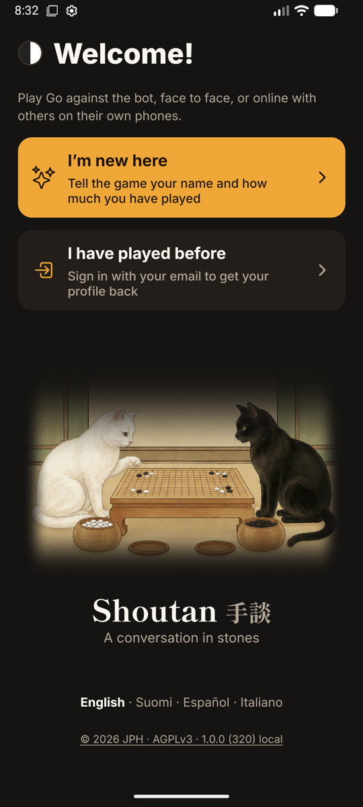
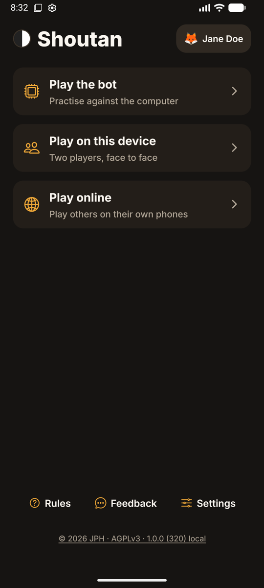
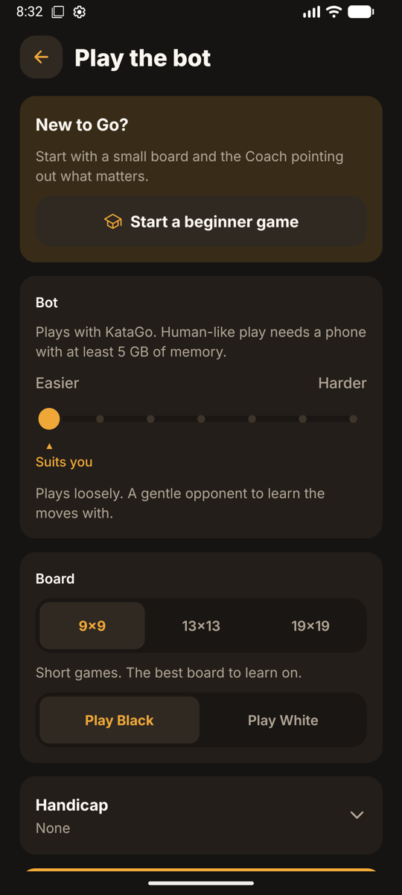
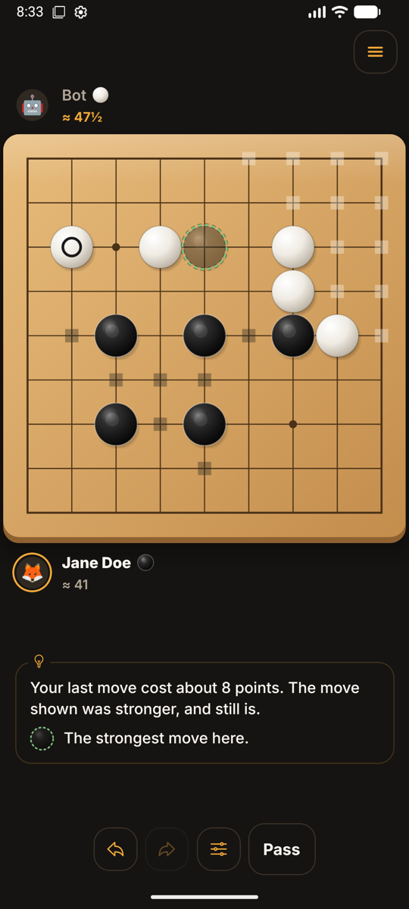
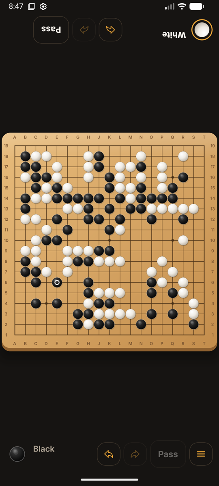
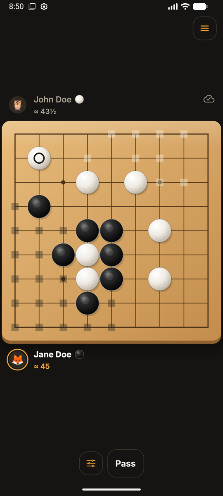
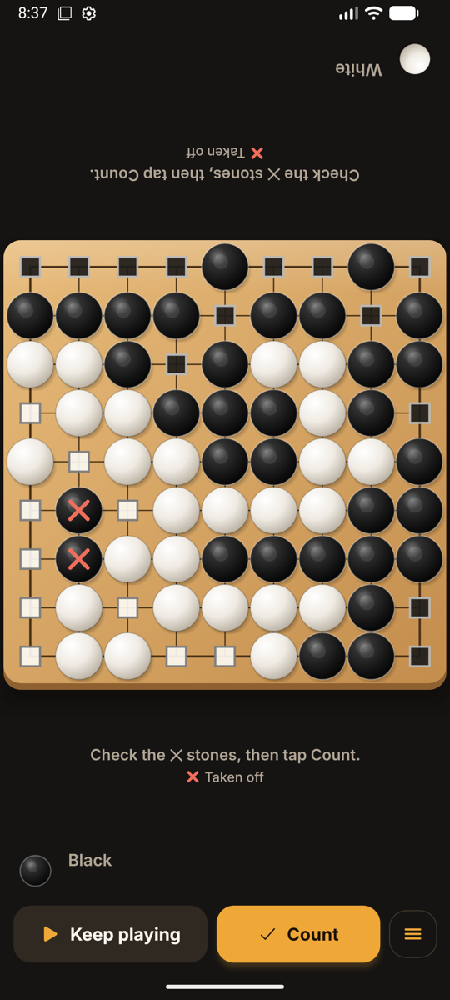
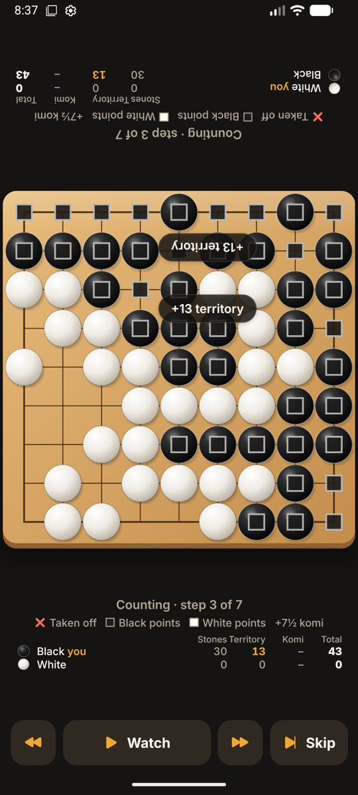
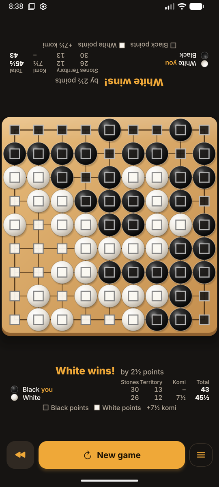
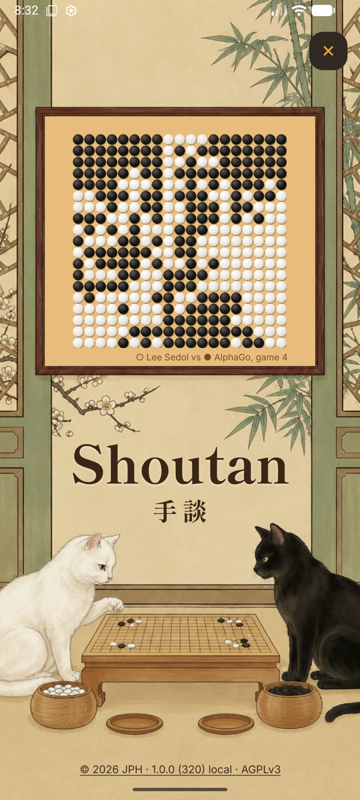

# Shoutan

Shoutan (手談, "hand talk", an old name for Go) is the board game Go for Android, made for first-time players as much as for experienced ones. You can play a computer opponent that matches your level, play face to face on one phone, or play online, each on your own phone.

| Welcome                                                                                                                                         | Main menu                                                                                                        | Choosing a bot                                                                                                                                         | The Coach                                                                                                                                                                      | Face to face¹                                                                                                                                                                            |
| ----------------------------------------------------------------------------------------------------------------------------------------------- | ---------------------------------------------------------------------------------------------------------------- | ------------------------------------------------------------------------------------------------------------------------------------------------------ | ------------------------------------------------------------------------------------------------------------------------------------------------------------------------------ | ---------------------------------------------------------------------------------------------------------------------------------------------------------------------------------------- |
|  |  |  |  |  |

| Online²                                                                                                                                                                                          | Marking dead stones³                                                                                                                                                   | Counting³                                                                                                    | Result³                                                                                                        | Cover                                                                                                                                     |
| ------------------------------------------------------------------------------------------------------------------------------------------------------------------------------------------------ | ---------------------------------------------------------------------------------------------------------------------------------------------------------------------- | ------------------------------------------------------------------------------------------------------------ | -------------------------------------------------------------------------------------------------------------- | ----------------------------------------------------------------------------------------------------------------------------------------- |
|  |  |  |  |  |

<sub>¹ Honinbo Shusaku against Honinbo Shuwa, 1846.<br>² The opening of GNU Go against GoKing, 2006 Computer Olympiad.<br>³ GNU Go against CrazyStone, 2006 Computer Olympiad.</sub>

## What's in it

- Go on 9×9, 13×13 and 19×19 boards, under the Chinese rules of 2002, with handicap stones.
- A computer opponent with seven levels. It runs [KataGo](https://github.com/lightvector/KataGo)'s neural networks on the phone itself, and on phones with 6 GB of memory or more it can play like a human of a chosen rank.
- Two players on one phone, with the screen laid out for people sitting opposite each other.
- Online games, each player on their own phone. Players find each other with a shared family code, and both phones check every move.
- The Guide for new players: suggested moves, liberties, groups, territory and a running score estimate. The level you give when you start decides which of these are switched on.
- A count that adds up the score one step at a time, so you can see where the points come from.
- A rating for each player, and a handicap that fits two players' ratings.
- English, Finnish, Spanish and Italian.

Everything except online play works without a connection. [docs/playing.md](docs/playing.md) goes through the app screen by screen.

## Rules

The app plays the [Chinese rules of 2002](https://weiqi.org.sg/wp-content/uploads/2025/09/The-Chinese-Rules-of-Weiqi.pdf) (English translation by Guo Juan 5p): area scoring, 7½ points of komi, and no move may repeat an earlier position. Handicap games follow the Chinese custom. [docs/rules.md](docs/rules.md) lists each rule with its article, and every rule has a test that quotes it.

## Status

This is an early version. Expect rough edges.

- It runs on Android only. The bot's network runs in a native Android module, so an iPhone version would need that ported first.
- Most of the code was written with AI coding agents, then reviewed and tested by the author. It is not production software, and it comes without warranty.
- Online play needs your own Supabase project. This repository holds the database schema and the script that sets a project up, but no server address or keys.
- The bot levels' ranks are estimates from games between the levels, not from games against people.
- The Finnish, Spanish and Italian texts haven't been reviewed by native speakers.

## Running it

You need Node 24 (see `.nvmrc`), JDK 21, the Android SDK and an emulator or a phone. The database tests also need Docker.

```sh
nvm use
npm ci
npx jest                   # the rules and the screens, about 20 seconds
npm run build:local        # builds dist/shoutan-local-<version>.apk
adb install -r dist/shoutan-local-*.apk
```

Without a server the app plays offline. For online play on your machine, start the local database with `npx supabase start` before building. `npm run verify` runs every check, and `npm run test:offline` runs the main device flow on the emulator with [Maestro](https://maestro.mobile.dev).

## Documentation

- [docs/playing.md](docs/playing.md): how the app works, for players.
- [docs/rules.md](docs/rules.md): the rules, article by article.
- [docs/bot.md](docs/bot.md): how the computer opponent plays and how its levels were measured.
- [docs/architecture.md](docs/architecture.md) and [docs/glossary.md](docs/glossary.md): how the code is organised, and the names it uses.
- [docs/development.md](docs/development.md): conventions for the bot, wording, languages, touch and the checks.
- [docs/releasing.md](docs/releasing.md): hosting, signing, releases and how online games stay honest.
- [AGENTS.md](AGENTS.md): working notes for coding agents, useful for people too.

## License and credits

Shoutan is free software under the GNU Affero General Public License, version 3 only. See [LICENSE](LICENSE). Copyright 2026 JPH.

- The bot uses KataGo's networks `kata1-b10c128` and `b18c384nbt-humanv0` by David J Wu ("lightvector"), under the KataGo licences, which are MIT-style. [modules/go-net](modules/go-net/README.md) says where they come from and how they were converted.
- The fonts are Inter and Shippori Mincho, under the SIL Open Font License 1.1.
- The cover picture was made by JPH with Google Gemini and ChatGPT. It is shared under the same licence as the app.
- The real games used in the tests come from GNU Go and other sources, listed with their licences in [src/go/\_\_tests\_\_/games/README.md](src/go/__tests__/games/README.md).
- The app's Licences page lists every library it ships, with its licence text.
