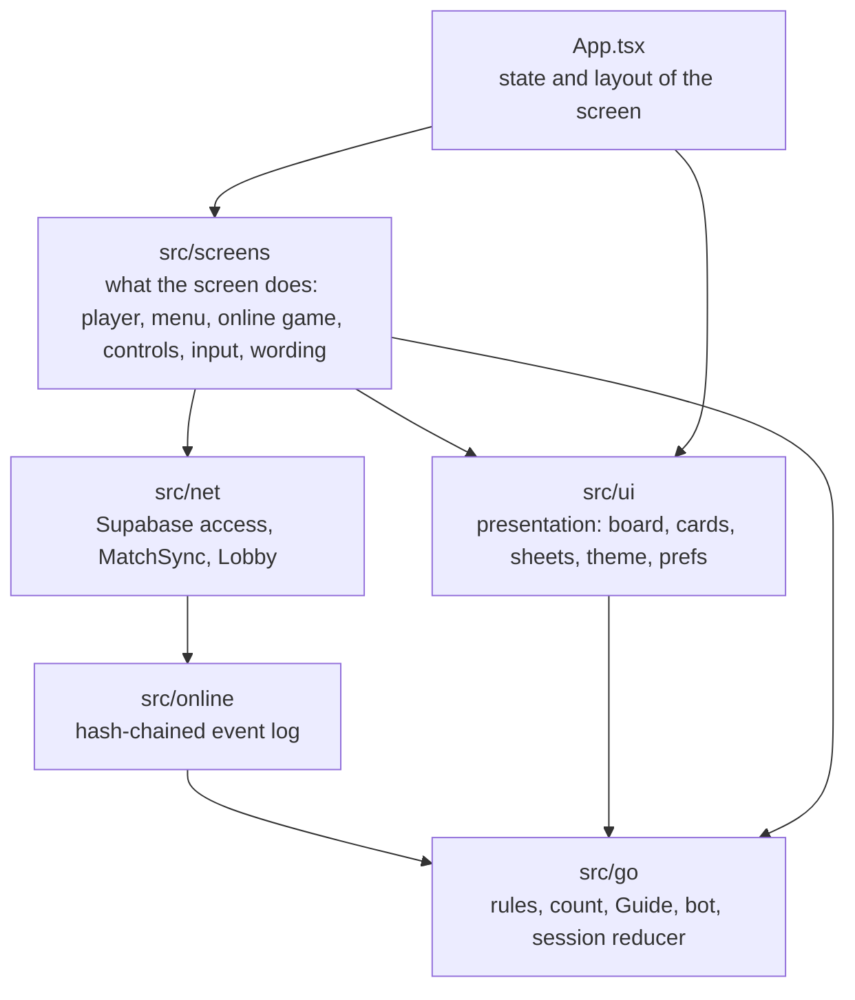

# Architecture

Shoutan is one game screen with modal sheets, built with Expo and React Native. This page explains how the code is layered, which file holds what, where state lives and how a move travels. `docs/releasing.md` explains the online integrity model.

## Layers

Dependencies point down only:

| Layer         | May import                                                            | Kept that way by                                                  |
| ------------- | --------------------------------------------------------------------- | ----------------------------------------------------------------- |
| `src/go`      | nothing else in the app; no React, Expo, clock or unseeded randomness | ESLint `pure-rules`                                               |
| `src/online`  | `src/go`                                                              | review                                                            |
| `src/net`     | `src/go`, `src/online`                                                | ESLint: only `src/net` and the online screens talk to the network |
| `src/ui`      | `src/go`, `src/config`, assets                                        | ESLint `offline-ui` (no network)                                  |
| `src/screens` | everything below                                                      | nothing needed                                                    |
| `App.tsx`     | everything                                                            | nothing needed                                                    |

`src/go` is plain TypeScript that runs the same in Node and Hermes, so the rules, the count and the bot are tested without a phone, and an online game replays identically on every phone.

## Files

- `src/go/`, pure TypeScript. Game logic changes go here, test-first, in `src/go/__tests__/`.
  - `rules.ts`: the immutable `GameState`, captures, suicide, superko, passing, dead marking, area score and handicap.
  - `count.ts`: territory regions and the step-by-step count the board plays after Count.
  - `guide.ts`: what the Guide sees from the rules (liberties; capture, ko and self-atari moments; the tactical reason for a move). `netHints.ts`: the Coach, from the network's reading (lost, weak and urgent chains, the strongest moves, what the last move cost).
  - `katago.ts`: the bot, levels 1 to 7, from the KataGo network's answer (`modules/go-net` runs the network natively; see its README). `human.ts`: the human-style network's rank profile and the human-like levels.
  - `ai.ts`: Monte Carlo playouts for the early-pass check, the score estimate and the dead-stone guess outside bot games.
  - `session.ts`: the one reducer the UI dispatches to. `finished.ts`: the record of a finished game the phone keeps. `sgf.ts`: reads SGF records.
- `App.tsx` is the whole screen: it holds the game's state and lays the screen out.
- `src/screens/`, what the screen does:
  - `shownGame.ts`: the game on screen, whichever it is, so the screen asks it instead of branching.
  - `usePlayer.ts`: the profile, kept games, the family lobby, the welcome and joining. `useGameRecord.ts`: saving after every move, the finished record and the rating. `historySync.ts` (rules in `history.ts`): finished games kept the same on the phone and in the account.
  - `useMoveInput.ts`: what a tap on the board does. `GameControls.tsx`: the control row and the face-to-face buttons, from the shown game's `controls`.
  - `onlineMatch.ts`: the open online game and the lobby, kept fresh, and sending moves.
  - `gameText.ts` and `onlineText.ts`: sentences that name a player, the result and the status lines.
  - `MainHub.tsx`: the main menu, with one file per page in `hub/` (setup, family lobby, profile, welcome) and what pages share in `parts.tsx`.
- `src/ui/`, presentation:
  - `GoBoard.tsx`: the SVG board's layout, stones and marks; touch, stone motion, territory, group outlines, ghost stones and callouts are in `board/`. `Stone.tsx` draws a stone.
  - `OptionsSheet.tsx`: the ☰ menu and the Settings page. `Menu.tsx`: what the main menu and the ☰ menu share. `Buttons.tsx`: buttons and switches.
  - `useGuide.ts`: the Guide's notes and liberty rings. `useNetHints.ts`: the Coach's ideas (not in online games). `TextBand.tsx`: the status, advice, result and scores beside the board.
  - `prefs.ts` and `usePrefs.ts`: choices remembered on the phone. `slices.ts`: the bot's move, the dead-stone guess and playouts in short slices.
  - `HelpSheet.tsx`, `ResultPanel.tsx`, `ScoreCount.tsx`, `Cover.tsx`, `LicencesSheet.tsx`; `theme.ts` (colours and fonts) and `copy.ts` (wording).
- `src/online/`, pure: the hash-chained event log (`log.ts`) and SHA-256. `src/net/` owns Supabase access; `match.ts` (`MatchSync`) keeps one game in sync and verifies every event and the stored summary. The app, the E2E opponent and the database tests all play through it.
- `android/` is generated by `npx expo prebuild` and gitignored.

## State

- **The game on this phone** is one immutable `Session`, changed only by `reduce` in `src/go/session.ts` through `dispatch`. Undo, redo, passing, marking dead stones and counting are actions, so they are tested as data.
- **An online game** is the event log on the server. `MatchSync` (`src/net/match.ts`) verifies every event and replays it with the same rules; `useOnlineMatch` keeps the game on screen fresh. The screen shows either the session or the open online game, through one interface: the **shown game** (`src/screens/shownGame.ts`), with the session and the online game as its two adapters, and a third for a finished game opened from the profile's list (`reviewGame`: replayed from its record, read-only, at its result, with the count). Whatever differs between them (who is viewing, what a tap or a button does, the status line, the result) is decided there, and tested on the session adapter directly and on the online one through the screen against a fake server.
- **Choices remembered on the phone** live in `src/ui/prefs.ts` (localStorage over expo-sqlite) and are held as React state by `usePrefs`, which hands the Guide and Options sheets one `Choices` object of value-and-setter pairs.
- **Who is playing** is the phone's one **profile**, with its saved game and kept games; the **account** (the email login kept on this phone, or none) only links that profile to the family. `useAccount` follows it; the connection and the lobby follow the account, while the profile and games stay put across sign-in and sign-out. When the family's player arrives, `usePlayer` reconciles the two: the family's name and animal win, and the phone's animal goes up if the family has none. The level and rating live on the server: the level chosen last on any of the account's phones wins, and the rating is the server's (worked out from the account's records) moved by the rated games this phone has not sent yet. Queued reports still belong to the account that made them. Presence is a time stamp on the player, touched while Play online or an online game is open; it affects no game, record or hash. Offline play needs no account; online play and feedback need one that is in the family, which the database also checks.
- **The player** (profile, kept games, family) is `usePlayer`; the finished-game record (written and replayed by `src/go/finished.ts`, kept by `prefs.ts`) and rating are `useGameRecord`.
- **History sync** (`src/screens/historySync.ts`, one `HistorySync` per signed-in account, its rules pure in `history.ts`) keeps the phone's finished games and the account's records on the server the same. A run, when the account is in the family: games played signed out are claimed by the account, unsent ones go up oldest first through `record_game` (a refusal marks the record and is not sent again), and the records the server kept since the last run come down (`my_game_records`, from a cursor stored on the phone) and merge by id or online game. It runs on sign-in, on joining, when the app comes back and after each kept game; a failed run waits for the next. When another account signs in, the first one's sent games leave the phone and its unsent ones wait, unlisted, for it to sign in again.
- There is no global store or context: `App.tsx` owns the state and passes it down. That keeps the data flow visible at one screen's size.

## A move, end to end

1. `useBoardTouch` (`src/ui/board/`) turns the finger into a board point, with aiming and holding.
2. `useMoveInput` (`src/screens/`) turns a first tap into a preview to confirm when tap twice is on, and passes any other tap to the shown game, which dispatches it to the session or sends it through `MatchSync`.
3. The new state renders: `GoBoard` draws it, `useStoneMotion` animates what changed, `useGameCues` plays the sound and haptic that `cueFor` chose, and `TextBand` and the player cards say what happened.
4. Against the bot, `useSessionWork` finds the bot's move and dispatches it. It encodes the position (`src/go/katago.ts`), the native module `modules/go-net` runs the network off the JS thread, and `katago.ts` picks the level's move from its answer. When the player chose the human-like bot (`Settings.botNet`, offered on phones with the memory), the human-style network (`src/go/human.ts`) proposes the moves and the small one judges.

## Native and build

Native projects are generated (`npx expo prebuild`) from `app.config.ts` and are not committed. The app's own native modules are autolinked from `modules/`: `go-net` (Kotlin, ONNX Runtime) runs the bot's networks, and `test-lab` tells a Firebase Test Lab device, where Google Play's pre-launch crawler signs in with made-up addresses, so the sign-in sends it no code: mail to them bounces, and too many bounces stop the project's sign-in mail. Builds run locally and in GitHub Actions, without EAS. There is no router: one screen plus modal sheets.

## Tests

- `src/go/__tests__`: rules, count, bot and reducer, with real games read from SGF. Coverage is gated on the pure code.
- `src/__tests__/app.test.tsx` and `online.test.tsx`: the whole screen rendered with React Native Testing Library, driven by taps and touches, offline and against a fake server.
- `supabase/tests`: the database functions and policies.
- `e2e/`: Maestro flows on an emulator, for what only a real device shows (layout, touch positions, animation, native config).

## Compared with common React Native practice

What follows the usual advice: a domain core free of React and tested on its own; one reducer for game state; side effects in hooks; presentation components that take plain data; lint rules that keep the layers apart; Continuous Native Generation from `app.config.ts`; screen tests through the rendered tree instead of implementation details; Maestro for device-only checks.

Where it differs, on purpose for now:

- **Folders by layer, not by feature.** At one screen the layers are the clearer split. If the app grows several screens, feature folders under `src/screens/` would be the next step.
- **No navigation library.** Expo Router would pay off with more than one screen and deep links; until then the modal sheets are simpler.
- **Prop passing instead of context.** `App.tsx` passes state to its pieces. Context would hide where state comes from without removing much code at this size.
- **The `Animated` API with the native driver** rather than Reanimated. It runs the board's animations on the UI thread already; Reanimated would matter for gesture-driven animation.
- **The bot runs natively; playouts run on the JS thread in slices.** The network runs off the JS thread; the playouts (early-pass check, score estimate, dead stones outside bot games) stayed in TypeScript, where they are tested with the rules.
